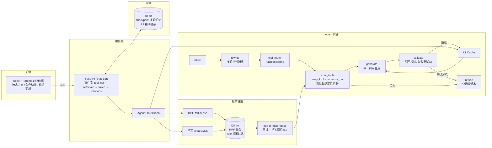

# enterprise-kb-agent

企业级智能知识库问答 Agent（RAG + Agent）。对 52 篇企业文档（制度 / API / FAQ，含角色权限标签）提供带引用的问答：混合检索（BGE-M3 + BM25 + RRF + rerank）召回，手写 LangGraph 状态机完成工具路由、拒答判定与引用校验重试，FastAPI SSE 流式返回，React（TypeScript）与 Streamlit 双前端提供交互界面。权限隔离端到端 0 泄漏，Redis L1 缓存 warm 命中 0.001s。

- **混合检索**：dense（BGE-M3）+ sparse（手写 jieba BM25）双路召回，Qdrant RRF 融合，bge-reranker-base 重排
- **Agent**：手写 StateGraph（route → rewrite → tool_router → exec_tools → generate → validate → refuse），支持多轮指代、对比题自动拆分检索、文档摘要
- **安全**：语料级 role 标签，检索期向上兼容权限过滤；阈值 0.7 拒答 + 引用校验失败重试（≤2）
- **体验**：SSE 事件流（检索轨迹 / token 增量 / 引用）+ React / Streamlit 双前端逐 token 渲染；L1 精确缓存加速重复问答

## 架构



## 核心特性

| 能力 | 实现 |
|---|---|
| 混合检索 | dense（BGE-M3）+ sparse（手写 jieba BM25）双路召回，Qdrant RRF 融合，bge-reranker-base 重排 |
| 权限隔离 | 语料带 role 标签，检索期 `expand_roles` 向上兼容过滤；端到端评估 0 权限泄漏 |
| 拒答机制 | 三层：检索阈值（离线标定 0.7）→ Agent 全拒判定 → 生成后引用校验失败重试（≤2）→ 拒答 |
| Agent 状态机 | 手写 langgraph StateGraph，7 节点 2 工具；多轮指代消解；对比题自动拆分多路检索（确定性正则兜底 LLM 路由） |
| 引用可追溯 | 每个事实句末尾 [n] 引用，程序化校验引用编号存在性，失败自动重试 |
| 流式体验 | FastAPI /chat SSE 事件流（检索轨迹 / token 增量 / 引用 / 拒答），Streamlit 逐 token 渲染 |
| 缓存加速 | Redis L1 精确缓存（query+role+语料版本 → 回答），warm 命中 0.001s/条；L2 checkpoint 多轮记忆 24h TTL |
| 文档摘要 | summarize_doc 工具：标题归一化反查 + map-reduce 长文档摘要 |

## 快速开始

### 方式一：Docker Compose 一键启动（推荐）

```bash
uv sync                                  # 下载模型权重用（Python 3.13）
cp .env.example .env                     # 填入 DEEPSEEK_API_KEY
uv run python scripts/download_models.py # BGE-M3 + reranker → data/models/（约 2.3GB，不入库）
docker compose up -d --build
# Web UI（Streamlit）: http://localhost:8501
# Web UI（React）:     make web-ui && 打开 http://localhost:8080
# API:                 http://localhost:8000/docs   （/health 检查服务与索引状态）
```

四容器（qdrant + redis-stack + api + web），语料与模型权重通过 `data/` 目录挂载。新环境首次启动时 Qdrant 索引为空，需先执行一次索引（容器内已具备依赖）：

```bash
docker compose exec api python scripts/index_corpus.py   # 增量索引 52 篇语料 → 370 chunks
```

或直接使用本机开发流程（方式二）完成索引后再 `docker compose up -d`。

### 方式二：本机开发

```bash
uv sync                                  # Python 3.13，依赖见 pyproject.toml
cp .env.example .env                     # 填入 DEEPSEEK_API_KEY
make infra                               # 起 qdrant + redis
uv run python scripts/download_models.py # BGE-M3 + reranker 权重 → data/models/
uv run python scripts/index_corpus.py    # 增量索引（--rebuild 全量重建）
make api                                 # FastAPI :8000
make web                                 # Streamlit :8501
cd frontend && npm ci && npm run dev     # React 前端 :5173（vite 代理 /chat → :8000，免 CORS）
```

React 前端（`frontend/`）开发模式走 vite proxy；直连 API 的场景（如 `vite preview`）在 `.env` 配 `CORS_ORIGINS=["http://localhost:5173"]`。生产形态用 `make web-ui`（nginx 托管构建产物 + API 反代，8080 端口）。

> 模型权重约 2.3GB，国内网络经 hf-mirror 镜像下载，支持断点续传。

## 使用方式

### Web UI

React（:5173 dev / :8080 生产）与 Streamlit（:8501）双前端，功能对齐：

- **问答**：输入问题 → 流式逐 token 渲染 + 引用高亮 → 展开工具轨迹面板（router 选择了哪些工具、每次检索的候选与 rerank 分数、延迟拆解）
- **角色切换**：public / contractor / employee / admin 四档，权限隔离实时生效（如 contractor 问年假会被拒答）
- **多轮对话**：同一 session 内支持指代（「那病假呢？」）
- **文档上传**：拖入 PDF/MD → 自动 chunk + 增量索引
- React 版额外修复：token 重试轮重置（不混拼）、error 事件可见反馈、对比题多路检索候选累积展示

### HTTP API

`POST /chat` 以 SSE 流式返回事件（`tool_call` → `retrieved` → `token` → `citations` / `refused`）：

```bash
# 单轮问答（role: public / contractor / employee / admin）
curl -N -X POST localhost:8000/chat \
  -H "Content-Type: application/json" \
  -d '{"question":"年假有几天？","role":"employee"}'

# 多轮对话（同一 session_id 内支持指代）
curl -N -X POST localhost:8000/chat \
  -H "Content-Type: application/json" \
  -d '{"question":"那病假呢？","role":"employee","session_id":"demo"}'

# 文档摘要
curl -N -X POST localhost:8000/chat \
  -H "Content-Type: application/json" \
  -d '{"question":"总结一下《差旅报销制度》","role":"employee"}'
```

其他端点：`POST /documents`（上传索引）/ `DELETE /documents/{doc_id}` / `GET /health` / `GET /chat/metrics`（延迟 P50/P95 窗口）。

## 评估结果

> 完整报告：[docs/eval_report.md](docs/eval_report.md)（检索基线 + 消融 §8 + Agent 端到端 §7/§11）。评估集：v2 123 条 QA × 6 场景（single_hop 27 / cross_doc 19 / comparison 20 / out_of_corpus 21 / permission 19 / multi_turn 17）。

| 指标 | 数值 |
|---|---|
| 答案正确率（LLM judge + 多数表决） | v1 32 条：**0.952**（21 条判分，§7）；v2 123 条全量重跑因 API 成本未做，修复验证轮难例子集 24 条有效条目 0.29→**0.54**、fresh 对比题 0.58→**0.75**（§11.3） |
| 检索 Hit@5 / MRR（v2 123 条基线） | **0.794 / 0.679**（§10.1） |
| 拒答准确率 | 检索层 **0.943**（应拒 34/40，漏拒 0.150；§10.1）；Agent 修复轮漏拒 0 |
| 权限隔离 | **0 泄漏**（permission 19 条 gold 从未出现在可见候选）；fail-open 主题错位 6/19 已披露（§10.1） |
| 引用覆盖 | **21/21**（v1） |
| L1 缓存 | **32/32 命中，0.001s/条**（warm 轮） |
| 端到端延迟 | 检索 7.09s/条（§10.1）；Agent cold 19.1s/条（难例子集，§11.3） |

复现评估：

```bash
uv run python scripts/eval_retrieval.py   # 检索基线（Hit@5/MRR/拒答双面）
uv run python scripts/eval_agent.py       # Agent 端到端（cold+warm 两轮 + judge）
```

## 项目结构

```
src/kb_agent/
├── agent/          # 手写 StateGraph：graph / prompts / tools / llm / state / cache
├── retrieval/      # hybrid_retriever / refusal(阈值) / citations / reranker 封装
├── ingest/         # chunker(结构感知) / sparse_bm25(手写) / indexer(增量 hash)
├── store/          # Qdrant 封装（RRF prefetch + role 过滤）
├── models/         # BGE-M3 embedder / bge-reranker-base
├── api/            # FastAPI：/chat SSE 事件流 / /documents 上传 / /health
├── web/            # Streamlit UI
└── eval/           # QA 集 / 指标 / flash judge / AgentEvalRunner
frontend/           # React + TypeScript 前端（手写 SSE 解析 / 轨迹面板 / nginx 部署）
├── src/lib/        # sse.ts（fetch ReadableStream 解析）+ api.ts
├── src/state/      # chatReducer（useReducer 流式状态机）
└── src/components/ # Sidebar / MessageList / AnswerView / ToolTrace / UploadPanel
data/
├── corpus/         # 52 篇语料（制度/API/FAQ/白皮书 × MD/PDF/TXT × role 标签）
├── qa_sets/v2/     # 123 条评估题 × 6 场景（gold chunk + 答案要点 + 权限期望）
├── index_cache/    # BM25 参数 + kb_version
└── reports/        # 评估报告 JSON
docs/               # 评估报告（eval_report）/ 基准（benchmarks）/ 人工测试记录
```

## 技术栈

Python 3.13 / uv · langgraph（手写状态机）· Qdrant（RRF 混合检索）· BGE-M3 + bge-reranker-base（FlagEmbedding）· jieba（手写 BM25）· FastAPI + SSE · React + TypeScript + Vite · Streamlit · nginx · Redis（checkpoint + L1 缓存）· DeepSeek（chat 生成 / flash 路由与 judge）· Docker Compose · pytest + ruff + vitest

## 已知限制

- **fail-open 主题错位**：permission 场景下目标文档被权限过滤挡住，可见文档的高分弱相关可能越过拒答阈值（检索层 6/19，评估报告 §10.1）——方向是生成前主题一致性校验，尚未实施
- **多 gold 覆盖不全**：部分考题需要多个 chunk 才能覆盖全部答案要点，检索深度不足时生成只能覆盖已召回的部分（评估报告 §11.3）
- **延迟**：冷路径约 7.1s/条（检索），大头是 CPU 上的 reranker（约 6.8s）——方向是 GPU 或蒸馏小模型
- **LLM judge 噪音**：flash 模型对表格类/边界答案判分有噪音，评估框架以多数表决缓解

## 测试

```bash
make test    # pytest 单测（全部 fake 化，不依赖真实模型/索引/Redis）
make lint    # ruff
```
