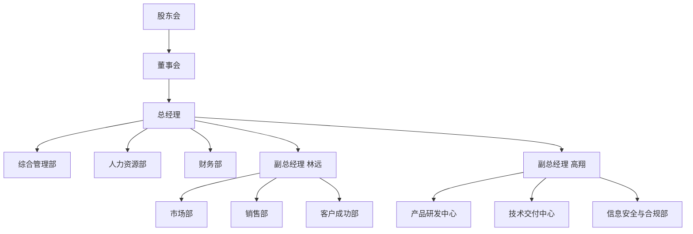

# 组织架构与岗位职责

## 组织架构

云帆科技有限公司（以下简称“公司”）实行股东会、董事会、总经理负责制。股东会为最高权力机构；董事会由5名董事组成，设董事长1名，监事3名。公司设总经理1名、副总经理2名、财务负责人1名。公司下设9个一级部门，总编制286人，其中高管3人，部门编制283人。2025年度经营目标为营业收入3.6亿元，净利润率不低于8%，研发投入4,500万元，占营业收入12.5%。

公司组织架构如下：

部门与负责人对照表如下：

| 序号 | 部门 | 负责人 | 职务 | 分管领导 | 编制 | 主要职责摘要 |
|---|---|---|---|---|---|---|
| 1 | 综合管理部 | 周敏 | 总监 | 总经理陈云帆 | 12 | 行政、公文、会议、印章、档案、资产、督办 |
| 2 | 人力资源部 | 李岚 | 总监 | 总经理陈云帆 | 10 | 招聘、薪酬绩效、培训、员工关系 |
| 3 | 财务部 | 王诚 | 总监 | 总经理陈云帆 | 9 | 预算、核算、资金、税务、审计 |
| 4 | 市场部 | 赵倩 | 总监 | 副总经理林远 | 18 | 品牌、市场活动、线索获取 |
| 5 | 销售部 | 刘峰 | 总监 | 副总经理林远 | 56 | 销售目标、回款、客户签约 |
| 6 | 产品研发中心 | 孙浩 | 总监 | 副总经理高翔 | 82 | 产品规划、研发、版本迭代 |
| 7 | 技术交付中心 | 吴涛 | 总监 | 副总经理高翔 | 64 | 项目实施、交付、运维 |
| 8 | 客户成功部 | 郑雪 | 总监 | 副总经理林远 | 24 | 客户服务、续约、增购 |
| 9 | 信息安全与合规部 | 何军 | 总监 | 副总经理高翔 | 8 | 信息安全、数据保护、合规审计 |

## 部门职责

综合管理部负责公司治理支持、公文流转、会议组织、印章证照、档案、固定资产、办公采购与后勤保障。公文流转不超过2个工作日，印章审批不超过1个工作日，固定资产每年6月、12月各盘点1次。

人力资源部负责组织发展、人员招聘、薪酬绩效、培训开发与员工关系。关键岗位招聘周期不超过45日，普通岗位不超过30日，年度人均培训不少于24学时，转正审批不超过5个工作日。

财务部负责全面预算、会计核算、资金管理、税务申报与内部审计。月度结账不超过5个工作日，报销审批不超过3个工作日，付款审批不超过5个工作日，季度预算执行分析于季后10日内完成。

市场部负责品牌传播、市场活动、行业研究及销售线索获取。年度市场预算1,200万元，线索转化率不低于18%，市场活动审批不超过5个工作日。

销售部负责区域与行业客户开拓、合同签署、回款管理及销售目标达成。2025年度销售目标3.6亿元，回款率不低于92%，销售费用率不超过10%，一般合同审批不超过3个工作日。

产品研发中心负责产品规划、需求管理、架构设计、研发测试与版本发布。年度研发投入4,500万元，版本迭代周期为6周，需求评审不超过3个工作日，代码评审覆盖率100%，P0缺陷24小时内修复。

技术交付中心负责项目交付、系统实施、运维保障及故障处理。项目按期交付率不低于95%，P1故障30分钟响应、4小时恢复，P2故障2小时响应、24小时恢复。

客户成功部负责客户培训、工单处理、续约增购与满意度管理。工单2小时响应，24小时解决率不低于90%，年度续约率不低于88%，NPS不低于45。

信息安全与合规部负责信息安全体系、数据保护、合规审查与风险审计。安全事件1小时内上报，数据每日增量备份、每周全量备份，备份保留180天，每年开展合规审计2次。

## 汇报关系

公司实行“董事会—总经理—分管领导—部门负责人—员工”的逐级汇报机制。总经理向董事会汇报，每月10日前提交上月经营分析报告，每季度首月15日前提交季度经营报告。副总经理林远分管市场部、销售部、客户成功部；副总经理高翔分管产品研发中心、技术交付中心、信息安全与合规部；总经理陈云帆直管综合管理部、人力资源部、财务部。各部门负责人向分管领导汇报，重大事项须同步总经理。

员工向直接上级汇报；项目型工作实行项目经理负责制，项目经理向项目发起人或分管领导汇报，项目成员行政关系不变。单笔预算内支出5万元以下由部门负责人审批，5万元（含）至20万元由分管副总审批，20万元（含）至50万元由总经理审批，50万元（含）以上报董事会审批。一般合同审批不超过3个工作日，重大合同不超过5个工作日。

会议机制方面，总经理办公会每周一召开；月度经营分析会每月10日召开；季度战略复盘会每季度首月20日召开；年度预算会于12月15日前完成审批。汇报材料须提前2个工作日提交至综合管理部。跨部门协同事项由综合管理部督办，原则上48小时内明确责任人与完成时限。
